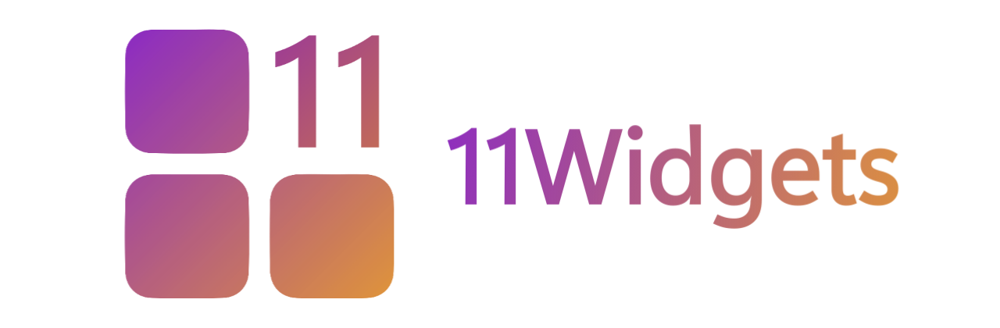
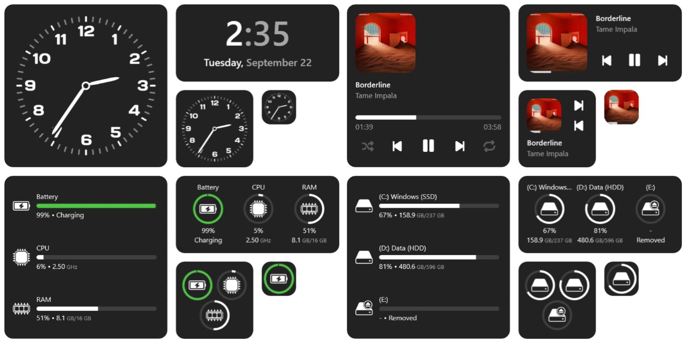
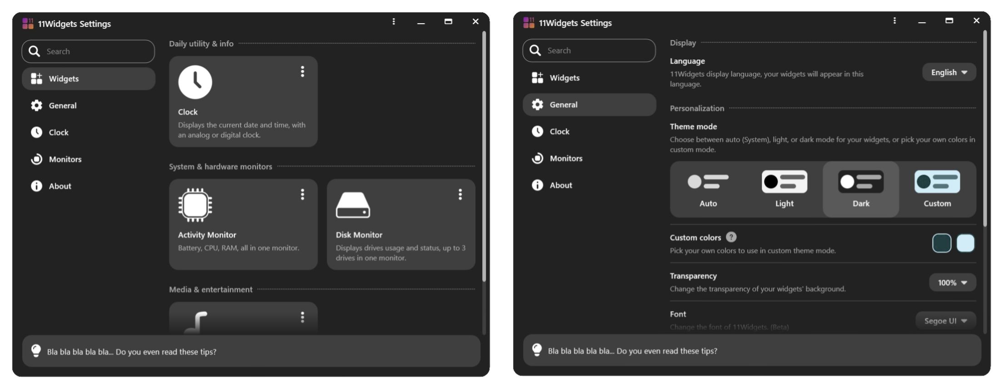

# 11Widgets

11Widgets is a [Rainmeter](https://www.rainmeter.net) skin package contains a lot of widgets that anyone can customize in personal way.

## Download & Installation

1. Download and setup [Rainmeter](https://www.rainmeter.net).
2. Navigate to the [Releases](https://github.com/11midooadel/11Widgets/releases) tab on this repository.
3. Download the latest `.rmskin` package.
4. Double-click the file to install and apply the skin via Rainmeter.

## Features

### Included Widgets
- **Clock:** Displays the current date and time, with an analog or digital clock.
- **Activity Monitor:** Battery, CPU, RAM, all in one monitor.
- **Disk Monitor:** Displays drives usage and status, up to 3 drives in one monitor.
- **Music Player:** Displays current track details alongside instant playback controls.

### Customization & Appearance
- **Sizes:** Every widget is available in four distinct sizes: **Small**, **Medium**, **Wide**, and **Large**.
- **Theme Modes:** Support for **Auto (System)**, **Light**, **Dark**, and **Custom** modes.
- **Custom Colors:** Pick your own colors to use in custom theme mode.
- **Layout & Display:** Built-in controls for transparency, font (beta), scale, and Z-Index positioning on the desktop.

## Settings Interface

Manage all features directly through the built-in 11Widgets Settings menu. 

- **Widgets:** Add/Remove widgets and manage their options.
- **General:** Language, personalization, transparency, font, scale, etc.
- **Clock:** Configure clock style, 12/24-hour formats, time cycles, seconds, and custom date formatting.
- **Monitors:** Toggle names, information displays, tooltips, histograms, and reorder activity monitor elements (Battery, CPU, RAM). Choose specific drives (e.g., C, D, E) and hide removable drives.
- **About:** About 11Widgets, check for updates, or report an issue.

## Special Thanks

- [Rainmeter Team](https://github.com/rainmeter) - [Rainmeter](https://github.com/rainmeter/rainmeter) (Desktop customization tool for Windows)
- [jsmorley](https://forum.rainmeter.net/memberlist.php?mode=viewprofile&u=85&sid=193b92d1ce57054d7efe85f39eb0a0b4) - [RainRGB Addon](https://forum.rainmeter.net/viewtopic.php?t=6215)
- [i2002](https://github.com/i2002) - [MediaPlayer Plugin](https://github.com/i2002/RainmeterMediaPlayer)
- [NighthawkSLO](https://github.com/NighthawkSLO) - [Mouse Plugin](https://github.com/NighthawkSLO/Mouse.dll)
- [deathcrafter](https://github.com/deathcrafter) - [TrayIcon Plugin](https://github.com/deathcrafter/PluginTrayIcon)

## License

[11Widgets](https://11widgets.pages.dev) © 2026 by [@11midooadel](https://github.com/11midooadel) is licensed under [CC BY-NC-SA 4.0](https://creativecommons.org/licenses/by-nc-sa/4.0/).

